# Data visualization and analysis projects

Two portfolio projects demonstrating data acquisition, cleaning, analysis, and visualization in Python and R. The analyses use public demographic, climate, and mortality data. They are intended to show a transparent workflow and communicate findings; they are not official population estimates or epidemiological studies.

## Projects at a glance

| Project | Question | Methods and outputs | Skills demonstrated |
|---|---|---|---|
| [US county population](#1-us-county-population-by-racial-group) | How was the 2010 population distributed across US counties and the selected racial groups? | County-level summaries, bar charts, choropleth, interactive map, and state/county dashboard | API data acquisition, joins, spatial data, exploratory analysis, static and interactive visualization |
| [Italy heatwave and mortality](#2-italy-summer-2022-temperature-and-mortality) | How did temperatures and all-cause mortality in Italy during summer 2022 compare with historical patterns? | ERA5 temperature processing, weekly mortality baseline model, excess-mortality estimates, and a binned temperature–mortality plot | Climate data, time-series preparation, regression, uncertainty-aware interpretation, reproducible analysis |

Each project has Python and R versions. The R notebooks are in `R/`; the Python notebooks are in `notebooks/`.

## Visual previews

The previews are grouped by project and language. GitHub displays the static figures below; interactive maps and dashboards must be run locally from the notebooks.

### Project 1 — US county population

#### Python outputs

<p align="center">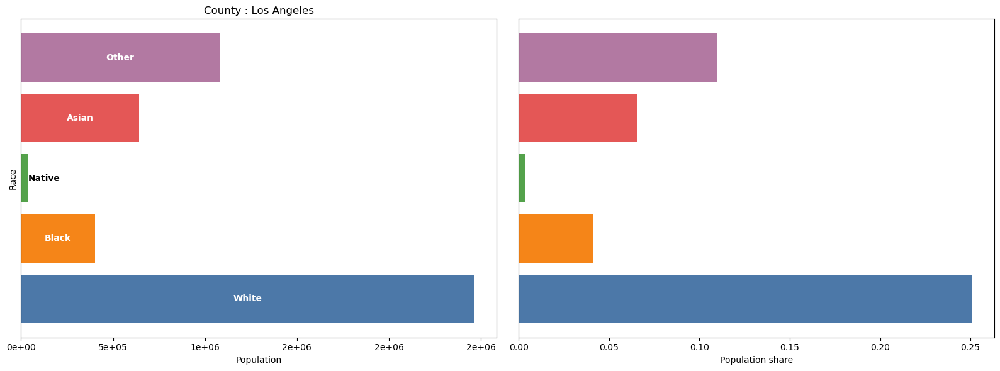 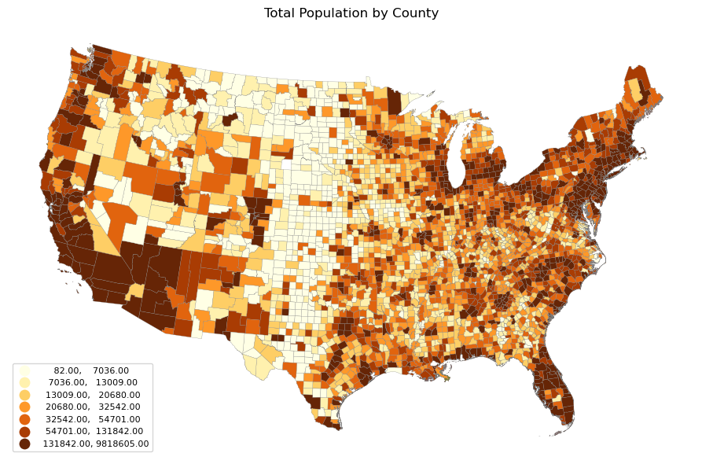</p>

#### R outputs

These figures were rendered in R from the county geometries and NHGIS population fields embedded in the saved project HTML output. The R Markdown notebook also contains the full IPUMS extraction workflow for reproducing the analysis from source.

<p align="center">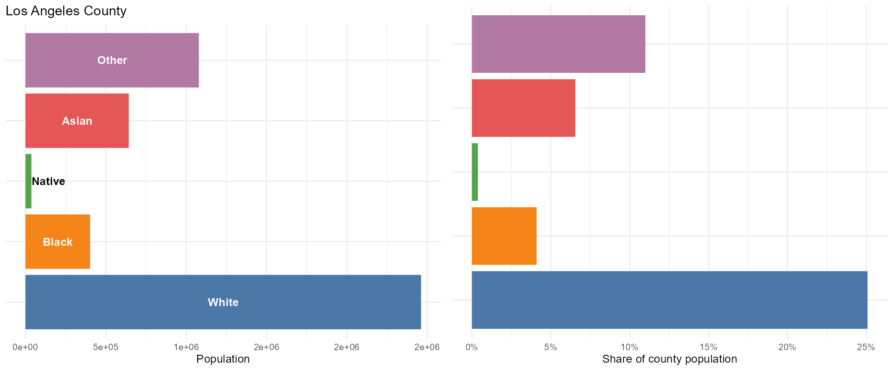 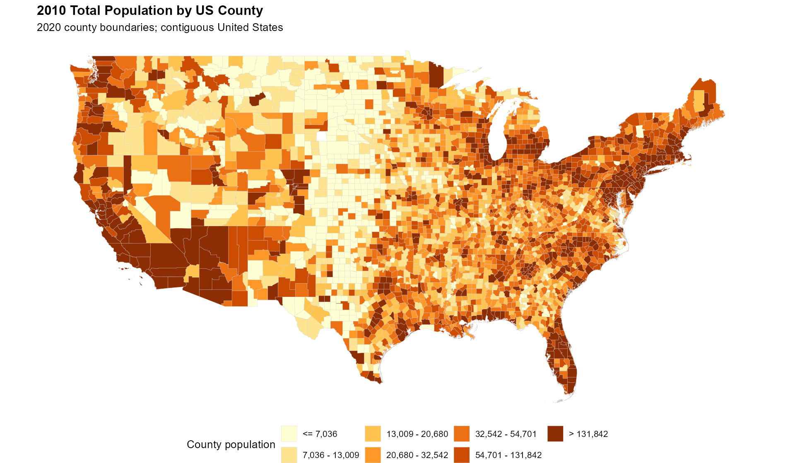</p>

### Project 2 — Italy heatwave and mortality

#### Python outputs

<p align="center">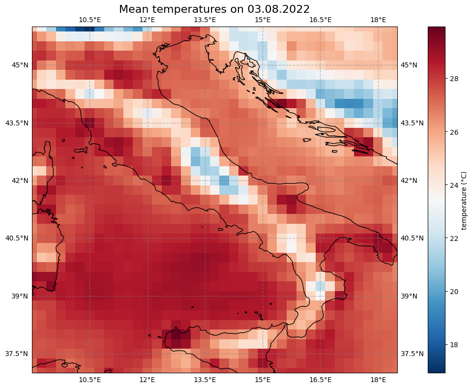 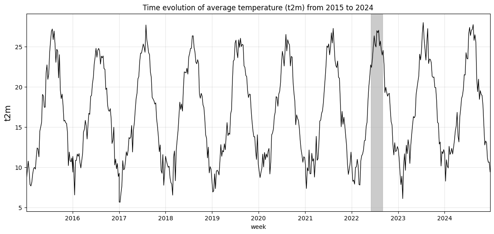</p>

<p align="center">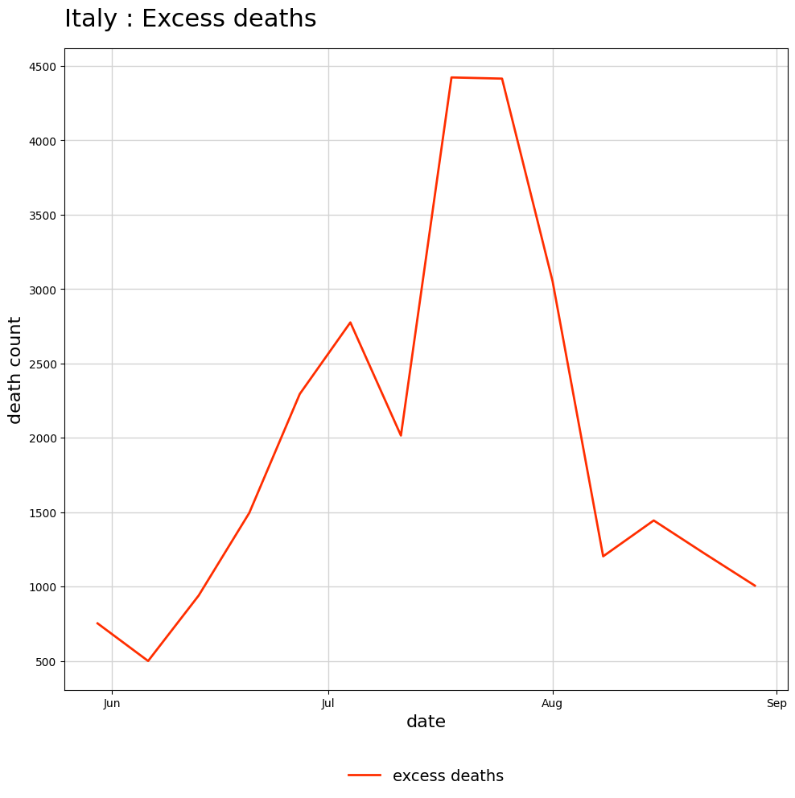 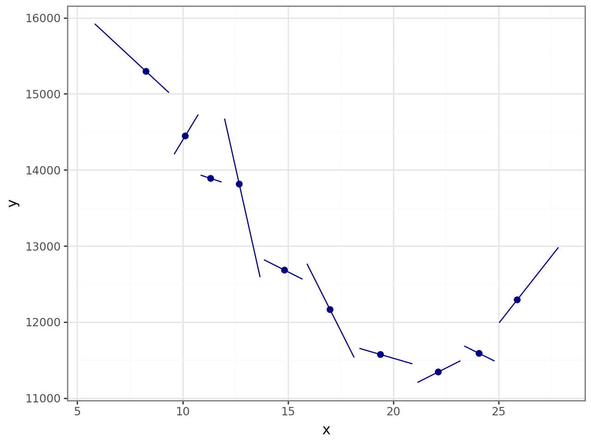</p>

#### R outputs

These figures were generated with R from the local `Italy_week_temperature.csv` and World Mortality Dataset CSV. The CSVs are not committed to the repository; follow the setup instructions to obtain them. With the simple pre-March-2020 baseline model, the estimated excess over weeks 22–35 of 2022 is about **27,536 deaths**. This is a model-based difference, not a count of deaths proven to have been caused by heat. The ERA5 temperature map is not shown here because the raw NetCDF downloads are not present; the R Markdown notebook can generate it after the CDS data are retrieved.

<p align="center">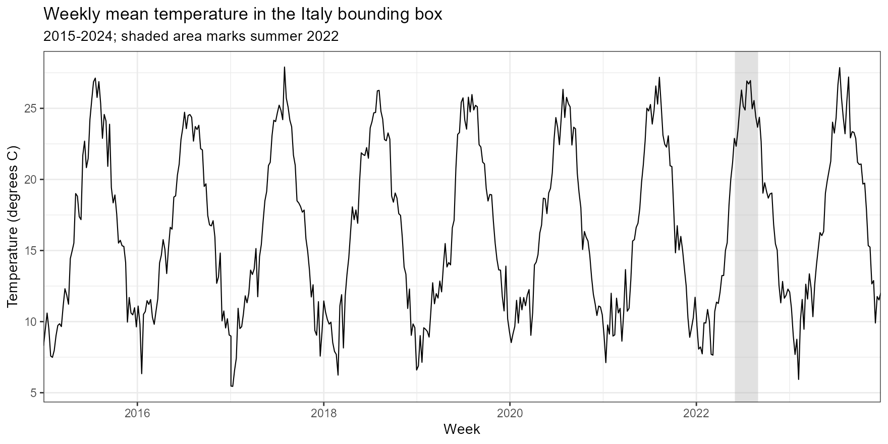 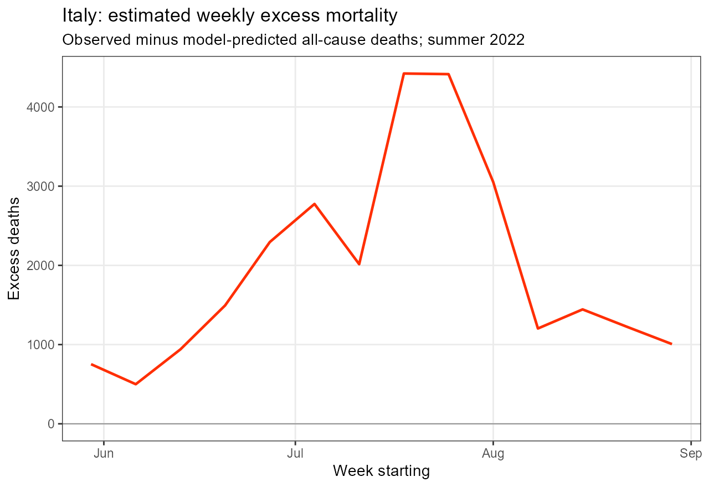</p>

<p align="center">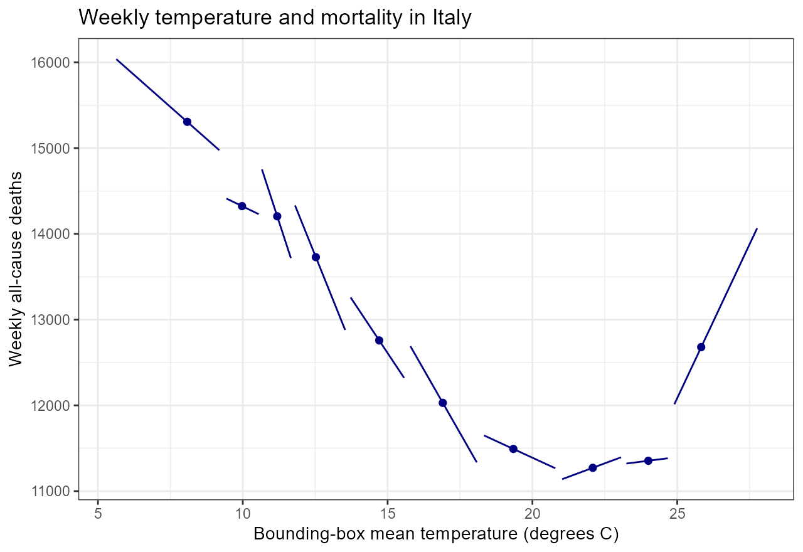</p>

## 1. US county population by racial group

### Objective

Explore 2010 county population counts across selected racial groups and communicate the geographic variation in total population across the contiguous United States.

### Approach

1. Request the 2020 county boundary shapefile and the 2010 county population table from IPUMS NHGIS.
2. Join the demographic table to county boundaries using the NHGIS geographic identifier (`GISJOIN`).
3. Aggregate the table's sex-by-race counts into the displayed groups and check that the group counts reconcile with the total.
4. Create population charts for Los Angeles County, a county-level choropleth, an interactive Leaflet/Folium map, and a dashboard for exploring a state and county.

The boundary vintage is 2020 while the population year is 2010; the map therefore uses 2020 county boundaries to display 2010 data. Both implementations exclude Alaska and Hawaii and focus on the contiguous states.

### Data

- County boundaries and population: [IPUMS NHGIS](https://www.nhgis.org/). An IPUMS API key is required to retrieve the extracts.
- The racial categories are derived from NHGIS table CW8. Check the table's metadata and category mapping before interpreting or reusing group totals.

## 2. Italy summer 2022 temperature and mortality

### Objective

Describe summer 2022 temperatures and all-cause mortality in Italy relative to the historical data available in the project, estimate a simple expected-mortality baseline, and explore how weekly temperature and mortality vary together.

### Approach

1. Retrieve hourly 2-metre air temperature from ERA5 for a bounding box around Italy through the Copernicus Climate Data Store (CDS) API.
2. Convert temperatures from Kelvin to Celsius, average hourly values to daily values, and calculate a cosine-of-latitude-weighted mean over the selected Italy bounding box. Aggregate daily values to ISO weeks.
3. Load the World Mortality Dataset, filter to Italy, and prepare weekly all-cause deaths.
4. Fit a baseline model to observations before 1 March 2020: a linear calendar-year trend plus week-of-year fixed effects. Predict weekly deaths for summer 2022 and calculate excess mortality as observed deaths minus predicted deaths.
5. Plot weekly temperature and mortality patterns and use a binned scatter plot to describe their observed association.

The code uses weeks 22–35 to represent the summer analysis window. It downloads ERA5 for 2015–2024, while the mortality baseline is trained on pre-March-2020 observations. These periods serve different purposes; the available years and filters should be checked when reproducing or extending the analysis.

### How to interpret the mortality estimate

The temperature bounding box includes sea areas and neighboring regions, so its weighted average is not a land-only national temperature series. The excess-mortality values are **model-based estimates**, conditional on a deliberately simple baseline. They are not a count of deaths proven to have been caused by the heatwave. The model accounts for a linear year trend and recurring week-of-year differences, but does not adjust for factors such as age structure, epidemics, changing population size, healthcare conditions, or other time-varying influences. The temperature–mortality plot is descriptive and does not establish a causal effect of temperature.

For a stronger analytical study, useful next steps would include checking the model's fit and residuals, comparing alternative baseline periods and specifications, quantifying prediction uncertainty, validating the weekly alignment between sources, and considering population-adjusted mortality and confounding factors. Results should be reported with these limitations alongside any headline estimate.

### Data

- Temperature: [ERA5 reanalysis](https://cds.climate.copernicus.eu/), accessed through the CDS API. Use is subject to the dataset's licence and CDS terms; users must accept the ERA5 licence on the CDS website.
- Mortality: [World Mortality Dataset](https://github.com/akarlinsky/world_mortality), compiled by Ariel Karlinsky and Dmitry Kobak. Place the required CSV at `data/world_mortality.csv` and follow the source dataset's citation and terms.

## Repository layout

```text
.
├── README.md
├── requirements.txt
├── .gitignore
├── notebooks/                 # Python notebooks
├── R/                         # R Markdown notebooks
├── img/                       # Static visual previews used in this README
└── data/                      # Local inputs and generated data; see .gitignore
```

The notebooks expect to be run from their respective `notebooks/` or `R/` directories and use relative paths. Downloaded extracts and generated files belong in `data/`. Keep API credentials out of the repository. Before publishing, confirm that `.gitignore` excludes credentials, downloaded data, and large generated outputs, and check that any files committed under `img/` are suitable for redistribution.

## Reproducing the analyses

### Python

From the repository root, create an environment, install the pinned or listed dependencies, then open the notebooks:

```bash
python -m venv .venv
# macOS/Linux
source .venv/bin/activate
# Windows PowerShell: .venv\Scripts\Activate.ps1
pip install -r requirements.txt
jupyter notebook notebooks/
```

Project 1 requires an IPUMS API key saved as `notebooks/ipums_key.txt` when running the Python notebook. Project 2 requires CDS API credentials and the mortality CSV described above. Follow the providers’ current instructions for configuring credentials; do not commit credential files.

### R

Install the packages used by the notebooks:

```r
install.packages(c(
  "tidyverse", "scales", "gridExtra", "sf", "leaflet", "htmlwidgets",
  "shiny", "ipumsr", "lubridate", "ecmwfr", "ncdf4",
  "rnaturalearth", "rnaturalearthdata", "aweek", "binsreg"
))
```

Open the `.Rmd` files in `R/` with RStudio. Run Project 1 with an IPUMS key in `R/ipums_key.txt` (ensure this file is ignored by Git). Project 2 requires CDS credentials configured with `ecmwfr::wf_set_key()` and `data/world_mortality.csv`. The first ERA5 download can take time and requires an active CDS account with the dataset terms accepted.

## Data, privacy, and licensing

Do not commit API keys, access tokens, private configuration files, or downloaded data unless redistribution is permitted by the source. Check the terms and citation guidance for NHGIS, ERA5, and the World Mortality Dataset before sharing derived or source data. The analyses and visualizations in this repository are provided for portfolio and educational purposes.

## Author

Add your name, contact details, and links to your portfolio or professional profiles here.
